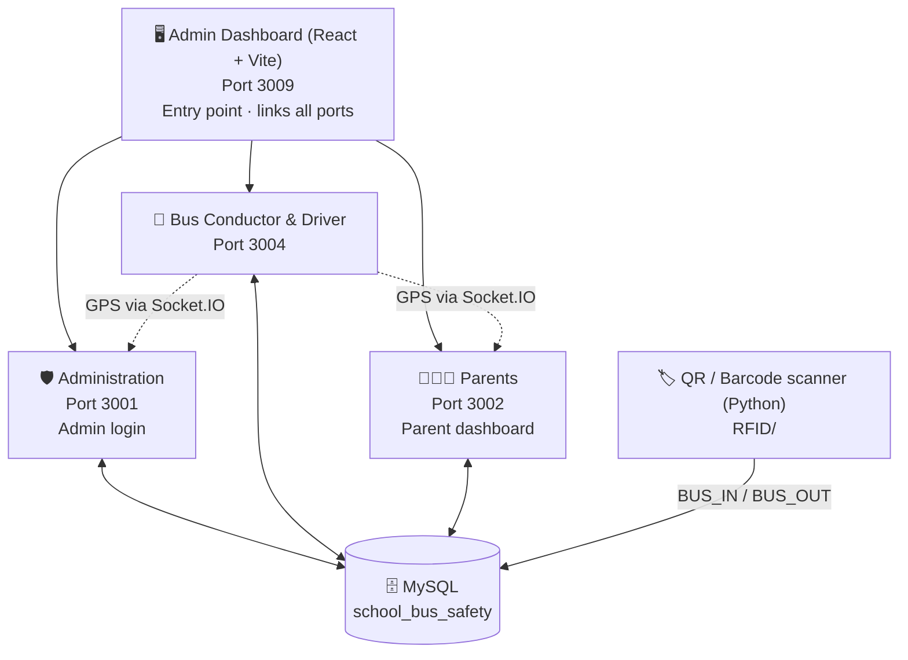

# 🚌 SchoolWay — Smart School Bus Safety & Tracking System

**AlgoStorm 2.0 · The Code Carnival · Team Couch Potato**

SchoolWay is a real-time school bus tracking and attendance system. Bus staff share live GPS locations, students board and deboard by scanning a QR/barcode ID, and parents see their child's bus and attendance on a live dashboard. Administrators manage buses, stops, students and absences from a central panel.

---

## ❗ Problem

Getting children to and from school safely is a daily worry for parents and schools:

- Parents don't know where the bus is, so they wait at stops with no idea of its arrival time.
- Schools usually track boarding and deboarding by hand, so it's easy to miss a child or lose track of who is on the bus.
- Absences and route changes don't reach the driver, conductor and school quickly, so buses wait for or stop for students who aren't coming.
- Administrators have no single view of buses, stops, students and attendance.

## 💡 Solution

SchoolWay connects parents, staff and administrators in one real-time system:

- **Live tracking:** the driver or conductor's device shares GPS location, and parents and admins see the bus on a live map.
- **Automatic attendance:** each student carries a QR/barcode ID. One scan logs `BUS_IN`, the next logs `BUS_OUT`, and the record is stored in MySQL.
- **Parent visibility:** parents get a dashboard with the bus location and can report their child absent in a few taps, which updates admin and conductor views.
- **Central control:** administrators manage stops, students, routes and absences, and can stop, resume or redirect a bus.
- **Role-based portals:** each user gets only the tools they need, from one entry point.

---

## ✨ Features

- **Live bus tracking**: GPS from the driver/conductor device streams over Socket.IO to a Leaflet / OpenStreetMap map.
- **Role-based portals**: separate apps for Administration, Bus Conductor & Driver, and Parents.
- **Barcode/QR attendance**: scan a student ID to log `BUS_IN` / `BUS_OUT` in MySQL.
- **Student ID generator**: create printable barcodes carrying student, bus, stop and parent details.
- **Stop & route management**: add/remove stops and assign students to stops (REST API).
- **Bus controls**: stop/resume bus, deviate/return to route, school mode.
- **Absence reporting**: parents mark their child absent; admin and conductor views reflect it.
- **Admin dashboard (React)**: overview, live fleet, students, attendance, staff and alerts.

---

## 🏗️ Architecture

The **Admin dashboard (port 3009)** is the entry point and links to every other service. Administrators log in and are sent to the Administration app (3001); drivers and conductors are sent to their app (3004); parents use their own dashboard (3002).



### Services and ports

| Folder | Port | Purpose |
|---|---|---|
| `school-bus-admin-dashboard/` | **3009** | React/Vite hub with role login; links to all other apps |
| `ADMIN/` | **3001** | Administration app: live map, stops, students, absences |
| `Parents/` | **3002** | Parent dashboard: live Bus 1 map, student lookup, mark absent |
| `BUS conductor and driver/` | **3004** | Conductor/driver app: share GPS, onboard list, add students, absences |
| `files/` | 3000 | Base real-time device tracker (the original version the apps above build on) |
| `RFID/` | n/a | Python desktop tools for barcode generation and attendance scanning |

---

## 🧰 Tech Stack

- **Frontend:** React 18, Vite, Leaflet, Lucide icons, vanilla HTML/JS portals
- **Backend:** Node.js, Express, Socket.IO
- **Database:** MySQL (XAMPP)
- **Scanner tools:** Python, OpenCV, pyzbar, Tkinter, python-barcode, Pillow

---

## 📁 Project Structure

```
.
├── ADMIN/                         # Administration server + UI (3001)
├── Parents/                       # Parent dashboard server + UI (3002)
├── BUS conductor and driver/      # Conductor & driver server + UI (3004)
├── files/                         # Base device tracker (3000)
├── school-bus-admin-dashboard/    # React/Vite admin hub (3009)
├── RFID/
│   ├── generate.py                # Student barcode generator
│   ├── read.py                    # Scanner (prints payload / optional API post)
│   └── database.py                # Scanner that writes attendance to MySQL
```

---

## ⚙️ Getting Started

### Prerequisites

- Node.js 18+ (20+ recommended)
- XAMPP (or any MySQL server) running on `127.0.0.1:3306`
- Python 3.9+ (only for the barcode tools)

### 1. Database

Start MySQL and create a database named `school_bus_safety` (default user `root`, empty password). The apps expect these tables:

| Table | Used for |
|---|---|
| `students` | `student_id`, `roll_no`, `student_name`, `bus_no`, `bus_stop`, `bus_drop`, `parent_mobile`, `Unique_ID`, `created_at`, `updated_at` |
| `attendance_events` | `student_id`, `bus_no`, `stop_name`, `reader_id`, `BUS_IN`, `BUS_OUT` |
| `absentes` | `ID`, `Name`, `Bus_stop`, `Timestamp` |

> The repo does not include a SQL schema file. Create the tables to match the columns above.

Optional environment variables (all four Node servers): `DB_HOST`, `DB_PORT`, `DB_USER`, `DB_PASSWORD`, `DB_NAME`, `STUDENT_TABLE`, `ABSENT_TABLE`, `POLL_MS`, `PORT`.

### 2. Start the Node services

Run each in its own terminal:

```bash
cd ADMIN && npm install && npm start                        # http://localhost:3001
cd Parents && npm install && npm start                      # http://localhost:3002
cd "BUS conductor and driver" && npm install && npm start   # http://localhost:3004
```

### 3. Start the admin dashboard

```bash
cd school-bus-admin-dashboard
npm install
npm run dev                                                 # http://localhost:3009
```

Windows users can use `run-windows.bat`; macOS/Linux users `./run-mac-linux.sh`.

### 4. Barcode tools (optional)

```bash
cd RFID
pip install opencv-python pyzbar mysql-connector-python python-barcode pillow requests
python generate.py     # create a student barcode
python database.py     # scan (webcam/image) and record BUS_IN / BUS_OUT in MySQL
```

Barcode payload format:

```
ID:1001|NAME:Rahul Sharma|BUS:12|STOP:Shankar Nagar|DROP:School Gate|MOBILE:9876543210
```

The first scan of the day records `BUS_IN`, the next records `BUS_OUT`.

---

## 🔐 Demo Login (Admin Dashboard)

| Role | Username | Password | Redirects to |
|---|---|---|---|
| Administration | `admin` | `admin123` | `:3001` |
| Driver | `driver1` | `driver123` | `:3004` |
| Conductor | `conductor1` | `conductor123` | `:3004` |
| Teacher | `teacher1` | `teacher123` | In-dashboard view |

Parents open `http://localhost:3002` directly.

---

## 🔌 API Overview

**Admin (3001) and Conductor/Driver (3004)**

| Method | Endpoint | Description |
|---|---|---|
| GET | `/api/stops` | List stops |
| POST | `/api/stops` | Add a stop |
| DELETE | `/api/stops/:id` | Remove a stop |
| POST | `/api/stops/:id/students` | Assign a student to a stop |
| DELETE | `/api/stops/:id/students/:name` | Remove a student from a stop |
| POST | `/api/students` | Register a student |
| GET | `/api/students/:id` | Look up a student |
| POST | `/api/absentes` | Mark a student absent |

**Parents (3002):** `GET /api/route1`, `GET /api/students/:id`, `GET /api/absentes/status/:id`, `POST /api/absentes`, `DELETE /api/absentes/:id`

**Socket.IO events:** `send-location`, `stop-bus`, `resume-bus`, `set-school-mode`, `deviate-bus`, `return-bus`

---

## ⚠️ Known Limitations

- The React dashboard's login is **front-end only** and not secure; use a real identity provider before production.
- Dashboard map markers are simulated; real GPS comes from the conductor/driver app.
- Credentials default to XAMPP's (`root`, no password). Change them for any real deployment.
- Do not use real student data on a publicly exposed instance.

---

## 👥 Team

Team **Couch Potato** — AlgoStorm 2.0: The Code Carnival.
